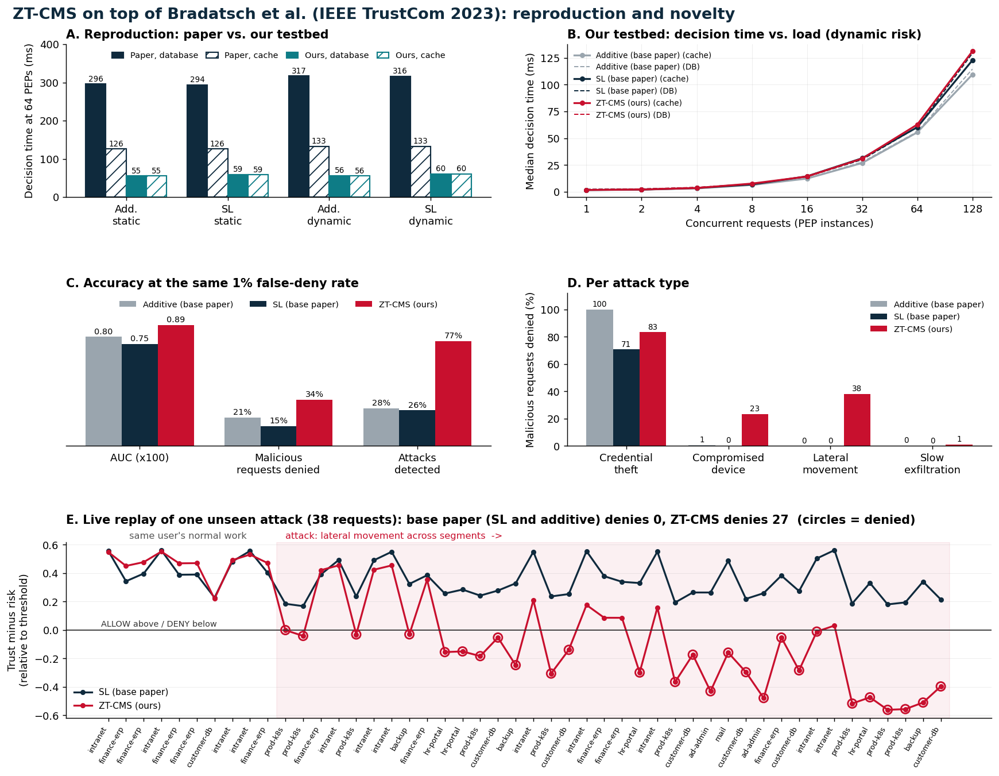

# ZT-CMS: Continuous Verification, Micro-Segmentation and Least Privilege for Score-Based Zero Trust

Capstone project, IIIT Dharwad: Parveen Kumar (23BCS093), Mann (23BCS078), Vishavjeet (23BDS069), Shreevats (23BDS055).

**Topic:** Zero Trust Architecture as an engineering discipline: continuous verification,
micro-segmentation and least-privilege enforcement in enterprise networks.

**Base paper (reproduced):** L. Bradatsch, O. Miroshkin, N. Trkulja, F. Kargl,
*"Zero Trust Score-based Network-level Access Control in Enterprise Networks,"* IEEE TrustCom 2023
([arXiv:2402.08299](https://arxiv.org/abs/2402.08299)).

**Our extension (ZT-CMS):** the paper's Subjective Logic trust algorithm plus
- **C**ontinuous verification: a running suspicion score per user and device that grows with repeated small anomalies and fades over about two hours;
- **M**icro-**S**egmentation: risk for segments new to the user and for fast fan-out across segments;
- least privilege: risk for access outside the user's role.



## Key results

| | Paper's SL | ZT-CMS (ours) |
|---|---:|---:|
| AUC | 0.748 | 0.888 |
| Malicious requests denied (1% false-deny rate) | 14.6% | 34.0% |
| Attack episodes detected | 26.1% | 77.0% |
| Extra decision time | – | +4.1% (cache), +4.7% (database) |

Reproduction of the paper's decision-time experiment (64 concurrent requests): see Table IV of our
paper and panel A above. On one laptop we confirm two of the paper's three relative claims.

## Repository layout

| Path | Contents |
|---|---|
| [ztsa_project/](ztsa_project/) | Python implementation, experiments, results ([details](ztsa_project/README.md)) |
| [paper/ztsa_ieee/](paper/ztsa_ieee/) | IEEE-format paper (LaTeX source and [PDF](paper/ztsa_ieee/ZT-CMS_IEEE_paper.pdf)) |
| [presentation/](presentation/) | Slide deck |

## Paper on Overleaf

[Open the paper in Overleaf](https://www.overleaf.com/docs?snip_uri=https%3A%2F%2Fraw.githubusercontent.com%2FShreevats4%2FZT-CMS%2Fmain%2Fpaper%2Fztsa_ieee_overleaf.zip)
(creates an editable copy in your Overleaf account from
[paper/ztsa_ieee_overleaf.zip](paper/ztsa_ieee_overleaf.zip); compiler: pdfLaTeX).

## Quick start

```powershell
python -m pip install -r requirements.txt
cd ztsa_project
python -m unittest -v ztsa.tests     # paper worked examples
python -m ztsa.showcase              # visual summary -> results/showcase/dashboard.png
python -m ztsa.accuracy --out results/accuracy
python -m ztsa.demo                  # live testbed (needs PostgreSQL 16 and openssl)
```
